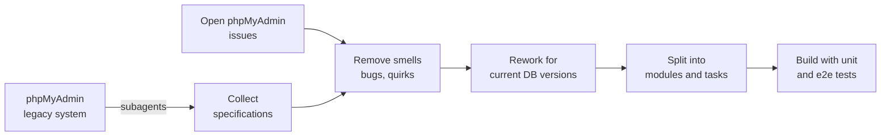

<div align="center">


<p>
  <a href="https://seym0n.github.io/dbloom/"><b>Website</b></a> ·
  <a href="https://seym0n.github.io/dbloom/docs/"><b>Docs</b></a> ·
  <a href="https://seym0n.github.io/dbloom/docs/quickstart/">Quickstart</a> ·
  <a href="https://seym0n.github.io/dbloom/docs/deploy/docker-compose/">Deploy</a> ·
  <a href="https://seym0n.github.io/dbloom/docs/guides/ai-assistant/">AI assistant</a> ·
  <a href="https://seym0n.github.io/dbloom/docs/concepts/security-model/">Security</a>
</p>

<p>
  
  
  
  
  
</p>

</div>

DBLoom is a modern, web-based database management system (DBMS) built with TanStack and TypeScript. It offers the same functionality as tools such as phpMyAdmin or Adminer, in a refreshed layout with extensive security features.

## Highlights

- **Self-hosted:** one Docker image for MySQL 8.4 and MariaDB 10.11, running on infrastructure you control.
- **Two login modes:** [account mode](https://seym0n.github.io/dbloom/docs/concepts/login-modes/) with DBLoom's own users, or direct mode with database credentials.
- **Security first:** runs behind your TLS reverse proxy, with an [audit log](https://seym0n.github.io/dbloom/docs/guides/audit-log/) and [protected settings](https://seym0n.github.io/dbloom/docs/guides/protected-settings/).
- **AI assistant:** translates requests into SQL without exposing the database to the public network. See [AI assistant](https://seym0n.github.io/dbloom/docs/guides/ai-assistant/).
- **Type-safe stack:** TanStack, with end-to-end type safety from server functions to routes.

## Screenshots

<table>
  <tr>
    <td width="50%">" /></td>
    <td width="50%">" /></td>
  </tr>
  <tr>
    <td width="50%">" /></td>
    <td width="50%">" /></td>
  </tr>
</table>

## Quickstart

```sh
docker compose -f compose.yaml -f compose.local.yaml up --build
```

Open `http://localhost:3000` and follow the first-time setup wizard. Details are in the [Quickstart](https://seym0n.github.io/dbloom/docs/quickstart/) or the guided [Setup](https://seym0n.github.io/dbloom/docs/setup/).

## Documentation

- [What is DBLoom](https://seym0n.github.io/dbloom/docs/)
- [Quickstart](https://seym0n.github.io/dbloom/docs/quickstart/) and [Setup](https://seym0n.github.io/dbloom/docs/setup/)
- [Docker Compose deployment](https://seym0n.github.io/dbloom/docs/deploy/docker-compose/)
- [Security model](https://seym0n.github.io/dbloom/docs/concepts/security-model/)
- [Backup, upgrade, rollback](https://seym0n.github.io/dbloom/docs/guides/backup-upgrade/)

## Motivation

I have used phpMyAdmin for a long time. Recent CVEs and growing concerns around PHP and phpMyAdmin motivated me to create a modern alternative based on TanStack.

Why TanStack? It provides end-to-end type safety from server functions to routes, and a client-first model with an explicit server boundary, without the RSC and caching complexity of Next.js.

AI also plays an ever-greater role in everyday life, so DBLoom features an integrated AI assistant that translates user requests into SQL commands without exposing the database to the public network.

## How DBLoom was built

DBLoom was built from scratch in nearly three weeks using AI-driven development. Rather than simply asking an AI to build a DBMS, I used spec-driven development:



1. **Collect specifications.** Subagents extracted specifications from an existing legacy system, phpMyAdmin.
2. **Remove smells.** Such specifications can contain smells, such as a still-unreported bug or a feature of a deprecated database version. All open phpMyAdmin issues were collected and checked against the specification, and relevant findings were amended.
3. **Rework for current versions.** Specifications tied to deprecated database versions were removed. Features that newer database versions added were considered and added where missing.
4. **Build in modules.** The reworked specification was split into several large modules of smaller tasks. Each task was developed with unit and end-to-end tests.
