# 09 — Views & Diagrams (Mermaid / UML)

Visualizations complementary to requirements documents 01–08. All diagrams are Mermaid and grounded in the legacy source (evidence noted per diagram). Entity names use the real class identifiers found in `libraries/classes/`, `templates/`, `setup/`. The source's own `doc/` folder is not used as evidence.

The UML views (class, sequence, state, ER) are standard UML expressed in Mermaid syntax; the remaining diagrams are C4-style context/container sketches expressed as flowcharts.

Review wave 1 summary: every diagram below was re-checked against the code; corrections are marked "(corrected in review wave 1)" and new views "(added in review wave 1)". Sections 9.12–9.15 are new.

Review wave 2 summary (added in review wave 2): diagrams were synchronised with the wave-1 findings in `reviews/` (tracking and designer data model from the 03 log; TOTP-only two-factor and WebAuthn without signature check from the 05 logs; server route catalogue from the 02 log; import/export plugin availability and upload-backend selection from the 04/06 log). Each changed element was re-verified against the code in this wave; changes are marked "(corrected in review wave 2)" and the new views 9.16–9.20 "(added in review wave 2)". The known code defects that the diagrams touch are collected in the table in `00-overview.md` section 6.

## 9.1 System context (C4 L0/L1) (corrected in review wave 1)

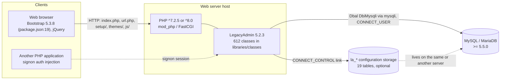

- Browser <-> LegacyAdmin <-> DBMS is the main triple. A `CONNECT_CONTROL` link is **always** established during boot: with `$cfg['Server']['controluser']` when it is non-empty, otherwise as a second connection using the user's own credentials; it is only *used* for `la_*` tables when configuration storage is configured (`Common.php:602-632`, `DatabaseInterface.php:100-110`). (corrected in review wave 1: the original said the control connection is opened only when configuration storage is configured)
- `la_*` tables: 19 `CREATE TABLE IF NOT EXISTS` statements in `sql/create_tables.sql` (lines 39, 56, 79, 98, 114, 128, 142, 159, 178, 195, 210, 232, 247, 261, 276, 293, 311, 331, 345; see ER in 9.5).
- External hyperlinks go through `url.php` (`UrlRedirector`), see `05-security-auth.md`.

## 9.2 Container / component view (C4 L2) (corrected in review wave 1)

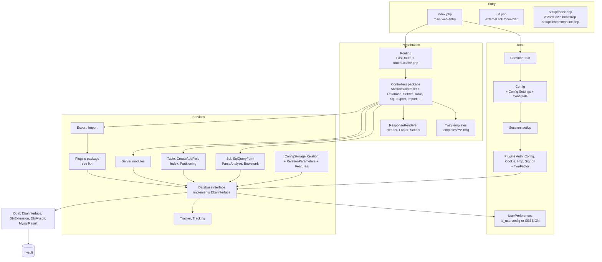

- `Common.php:100-298` gives the call order shown in Boot: config, `Session::setUp` (`:123`), authentication (`:225-226`), DB connection (`:236`), then `loadUserPreferences` (`:289`). `index.php:40-43` runs `Common::run()` and only afterwards the routing. (corrected in review wave 1: preferences load after authentication/connection, not before)
- `Routing.php:38-50`: `getDispatcher()` requires `libraries/routes.php` and builds the dispatcher with `routesCachedDispatcher`; the cache file is skipped when `$cfg['environment'] === 'development'` (`skipCache()`).
- `DatabaseInterface::tryQuery` calls `Tracker::handleQuery` for every successful query when `Tracker::isActive()` (`DatabaseInterface.php:267-268`), hence the dashed edge DBI -> TRK.
- Controller folders under `libraries/classes/Controllers/`: top-level controllers plus sub-folders `Config`, `Database`, `Export`, `Import`, `Preferences`, `Server`, `Setup`, `Sql`, `Table`, `Transformation`, `View` (directory listing re-verified in review wave 1; the former list "Status, Variables, Privileges, ..." named nested folders that live inside `Server/`, `Database/` or `Table/`).

## 9.3 UML sequence — HTTP request lifecycle (corrected in review wave 1)

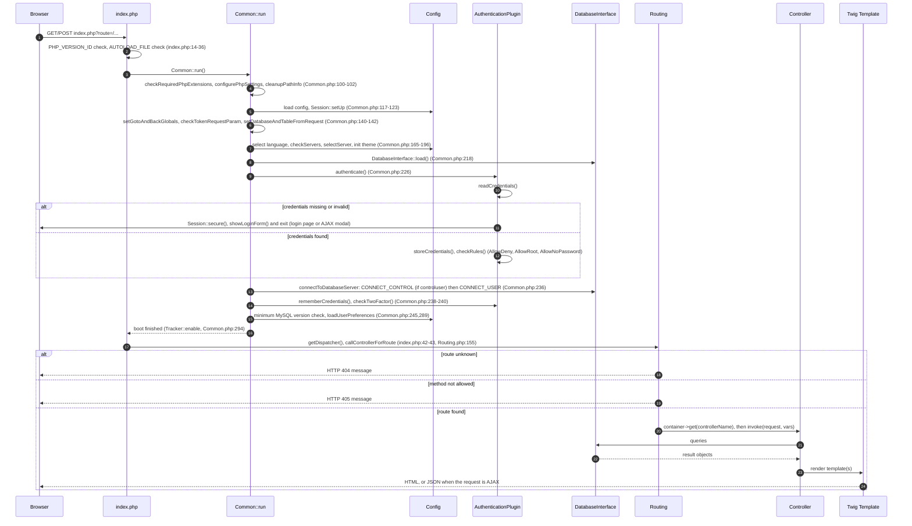

## 9.4 UML class diagram — plugin framework (corrected in review wave 1; corrected in review wave 2)

Evidence: `libraries/classes/Plugins/{Plugin,ExportPlugin,ImportPlugin,SchemaPlugin,AuthenticationPlugin,TwoFactorPlugin,TransformationsPlugin,TransformationsInterface,IOTransformationsPlugin,UploadInterface}.php`. Only Export, Import and Schema plugins implement `Plugin`; Authentication and TwoFactor plugins are independent base classes.

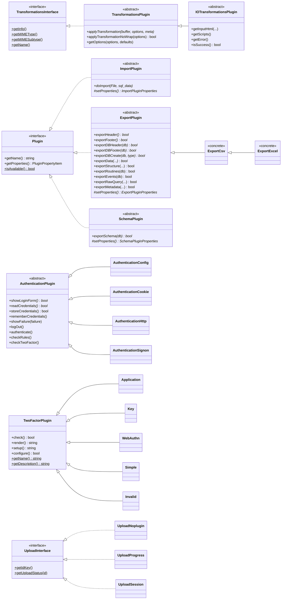

**Concrete inventory discovered** (counts re-verified from directory listings; full listing in `06-plugins.md`):

| Family | Bundled concrete classes |
|---|---|
| Export (15) | `ExportCodegen`, `ExportCsv`, `ExportExcel`, `ExportHtmlword`, `ExportJson`, `ExportLatex`, `ExportMediawiki`, `ExportOds`, `ExportOdt`, `ExportPdf`, `ExportPhparray`, `ExportSql`, `ExportTexytext`, `ExportXml`, `ExportYaml` (+ `Export/Helpers`) |
| Import (7 + 3 upload) | `ImportCsv`, `ImportLdi`, `ImportMediawiki`, `ImportOds`, `ImportShp`, `ImportSql`, `ImportXml` (helpers `AbstractImportCsv`, `ShapeFileImport`); upload providers `UploadNoplugin`, `UploadProgress`, `UploadSession` |
| Transformations (27) | `Plugins/Transformations/Input` (8: `Image_JPEG_Upload`, `Text_Plain_FileUpload`, `Text_Plain_Iptobinary`, `Text_Plain_Iptolong`, `Text_Plain_JsonEditor`, `Text_Plain_RegexValidation`, `Text_Plain_SqlEditor`, `Text_Plain_XmlEditor`), `Output` (15), top-level (4: `Text_Plain_Link`, `Text_Plain_Longtoipv4`, `Text_Plain_PreApPend`, `Text_Plain_Substring`); 18 abstract bases in `Abs/` |
| Auth (4) | `AuthenticationConfig`, `AuthenticationCookie`, `AuthenticationHttp`, `AuthenticationSignon` |
| Two-factor (5) | `Application`, `Key`, `WebAuthn`, `Simple`, `Invalid` (fallback when the configured backend is unavailable, `TwoFactor.php:193-200`) |
| Schema (4) | `SchemaDia`, `SchemaEps`, `SchemaPdf`, `SchemaSvg` (helpers in `Schema/Dia|Eps|Pdf|Svg`, `ExportRelationSchema`, `TableStats`, `RelationStats`) |

(added in review wave 2) Verified details: `ExportPlugin` also defines the non-abstract `exportMetadata()` (`ExportPlugin.php:193`) and a `final` constructor; "CSV for MS Excel" (`ExportExcel`) is a subclass of `ExportCsv` (`ExportExcel.php:23`), i.e. a CSV dialect and not an XLSX writer (FR-IOX-072). `Plugins::getPlugin()` builds the class name from type and format and does not call `isAvailable()`; `getPlugins()` (used for the UI lists) keeps only classes that are subclasses of `Plugin` and report `isAvailable()` (`Plugins.php:60-73,139-142`). Format availability is therefore conditional, not universal: `ExportXml::isAvailable()` is true only when a database is selected (no server-scope XML export, `ExportXml.php:551-557`), and `ExportPdf::isAvailable()` requires the TCPDF class and the `curl` extension (`ExportPdf.php:334-337`) (FR-IOX-001, FR-PLG-005, DEP-PLG-001).

(added in review wave 2) Upload-progress backends: three provider classes exist, but `Import\Ajax::uploadProgressSetup()` iterates only `['progress', 'noplugin']` (the `session` entry is commented out, `Import/Ajax.php:42-60`), so `UploadSession` is never selected at run time even though `session.upload_progress.enabled` may be on (FR-IOX-060, DEP-PLG-003).

Availability of 2FA backends is computed in `TwoFactor::getAvailableBackends()`: `simple` only if `$cfg['DBG']['simple2fa']`, `application` if Google2FA + ImageRenderer + (XMLWriter or imagick) exist, `WebAuthn` always, `key` if `U2FServer` exists (`TwoFactor.php:129-152`). (corrected in review wave 2: the `application` backend is time-based OTP only — `Application.php` calls `Google2FA::verifyKey` with `setWindow(8)`; no HOTP/counter mode is implemented although the plugin's description string mentions HOTP, FR-SAU-054. See view 9.16.)

## 9.5 UML ER diagram — configuration storage (`sql/create_tables.sql`) (corrected in review wave 1; checked again in review wave 2)

19 tables (prefix `la_` by default; the actual table names are configurable per server). The schema declares **no foreign-key constraints**; the links below are *logical* references maintained by application code (`ConfigStorage/Relation.php`, `RelationParameters.php`, `ConfigStorage/Features/*`, 18 feature classes). Column names and keys are exactly those of the DDL.

```mermaid
erDiagram
    la_users }o--|| la_usergroups : "usergroup (logical)"
    la_pdf_pages ||--o{ la_table_coords : "page_nr = pdf_page_number (logical)"

    la_users {
        varchar username PK
        varchar usergroup PK
    }
    la_usergroups {
        varchar usergroup PK
        varchar tab PK
        enum allowed PK "Y or N, default N"
    }
    la_bookmark {
        int id PK
        varchar dbase
        varchar user
        varchar label
        text query
    }
    la_column_info {
        int id PK
        varchar db_name UK
        varchar table_name UK
        varchar column_name UK
        varchar comment
        varchar mimetype
        varchar transformation
        varchar transformation_options
        varchar input_transformation
        varchar input_transformation_options
    }
    la_history {
        bigint id PK
        varchar username
        varchar db
        varchar table
        timestamp timevalue
        text sqlquery
    }
    la_pdf_pages {
        int page_nr PK
        varchar db_name
        varchar page_descr
    }
    la_recent {
        varchar username PK
        text tables
    }
    la_favorite {
        varchar username PK
        text tables
    }
    la_table_uiprefs {
        varchar username PK
        varchar db_name PK
        varchar table_name PK
        text prefs
        timestamp last_update
    }
    la_relation {
        varchar master_db PK
        varchar master_table PK
        varchar master_field PK
        varchar foreign_db
        varchar foreign_table
        varchar foreign_field
    }
    la_table_coords {
        varchar db_name PK
        varchar table_name PK
        int pdf_page_number PK
        float x
        float y
    }
    la_table_info {
        varchar db_name PK
        varchar table_name PK
        varchar display_field
    }
    la_tracking {
        varchar db_name PK
        varchar table_name PK
        int version PK
        datetime date_created
        datetime date_updated
        text schema_snapshot
        text schema_sql
        longtext data_sql
        set tracking
        int tracking_active
    }
    la_userconfig {
        varchar username PK
        timestamp timevalue
        text config_data
    }
    la_navigationhiding {
        varchar username PK
        varchar item_name PK
        varchar item_type PK
        varchar db_name PK
        varchar table_name PK
    }
    la_savedsearches {
        int id PK
        varchar username UK
        varchar db_name UK
        varchar search_name UK
        text search_data
    }
    la_central_columns {
        varchar db_name PK
        varchar col_name PK
        varchar col_type
        text col_length
        varchar col_collation
        boolean col_isNull
        varchar col_extra
        text col_default
    }
    la_designer_settings {
        varchar username PK
        text settings_data
    }
    la_export_templates {
        int id PK
        varchar username UK
        varchar export_type UK
        varchar template_name UK
        text template_data
    }
```

Notes:
- Per-user tables keyed by `username` (logical link to the MySQL account name, not to `la_users`): `recent`, `favorite`, `table_uiprefs`, `userconfig`, `navigationhiding`, `savedsearches`, `designer_settings`, `export_templates`, `history`; `la_bookmark` uses column `user`. `la_users` + `la_usergroups` implement user groups (menu-tab allow list), see `02-server.md`; `la_central_columns`, `la_column_info`, `la_relation`, `la_table_info`, `la_tracking`, `la_table_coords`/`la_pdf_pages` are keyed by database/table, not by user. (The former diagram showed non-existent FK edges from `la_users` to all of these and invented columns such as `usergroups.tab_allowed`, `relation.db_name` and `savedsearches` as JSON-of-QBE only; corrected.)
- `la_column_info` underpins the transformation framework (`mimetype`, `transformation*`, `input_transformation*`), see `06-plugins.md`. `la_tracking.tracking` is a `SET` of 17 statement kinds (`UPDATE` ... `DROP VIEW`, `create_tables.sql:219`).
- All tables use `DEFAULT CHARACTER SET utf8 COLLATE utf8_bin`.
- (added in review wave 2) Re-checked against the DDL for the three tables flagged in the wave-1 database review: `la_tracking` (PK `db_name, table_name, version`), `la_pdf_pages` (PK `page_nr` only, auto_increment, plain `KEY db_name`) and `la_table_coords` (PK `db_name, table_name, pdf_page_number`); `la_navigationhiding` has the five-column PK shown. Behaviour views: tracking 9.17, designer 9.18.
- Full column details are cited in `08-deployment-docs.md`.

## 9.6 UML state diagram — authentication lifecycle (corrected in review wave 1)

Derived from `Common::run` (`Common.php:225-243`), `AuthenticationPlugin::authenticate/checkRules/checkTwoFactor` (`AuthenticationPlugin.php:250-345`) and `AuthenticationCookie::readCredentials` (`AuthenticationCookie.php:280-390`).

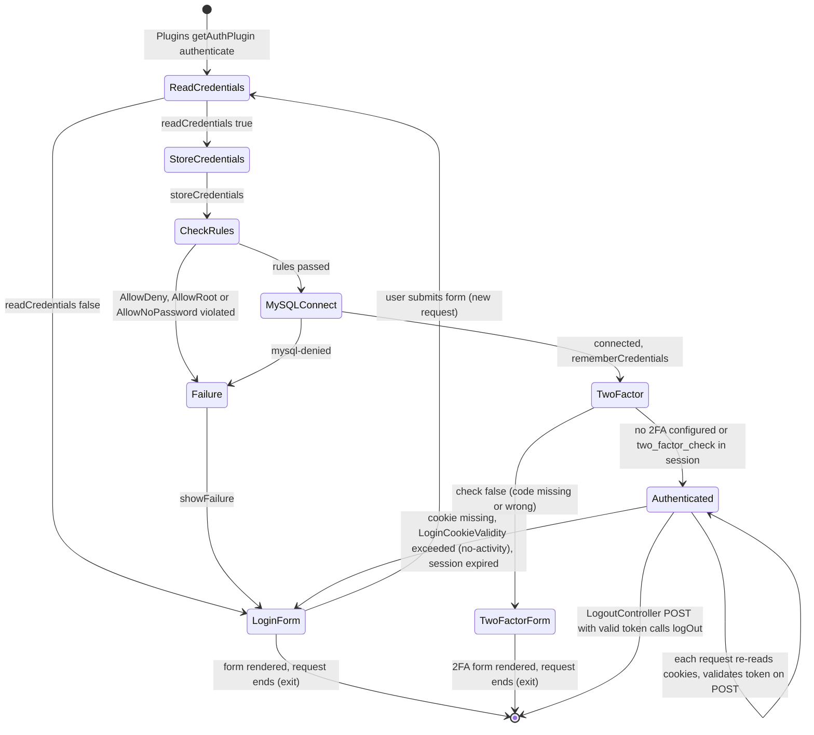

(added in review wave 2) The `TwoFactor` state is detailed for TOTP and WebAuthn in view 9.16; credential cookies are issued before the second factor is confirmed.

Notes: with `Invalid` 2FA backend, `check()` always returns false (`Plugins/TwoFactor/Invalid.php:26-29`) so the user stays in `TwoFactorForm`. With `config` auth `readCredentials` succeeds immediately; with `http` and `signon` the plugin-specific form replaces `LoginForm`. During session expiry an AJAX request receives the login form as a modal plus `new_token` (`AuthenticationCookie.php:85-98`). Details and evidence per branch: `05-security-auth.md`.

## 9.7 UML sequence — export data flow (corrected in review wave 1)

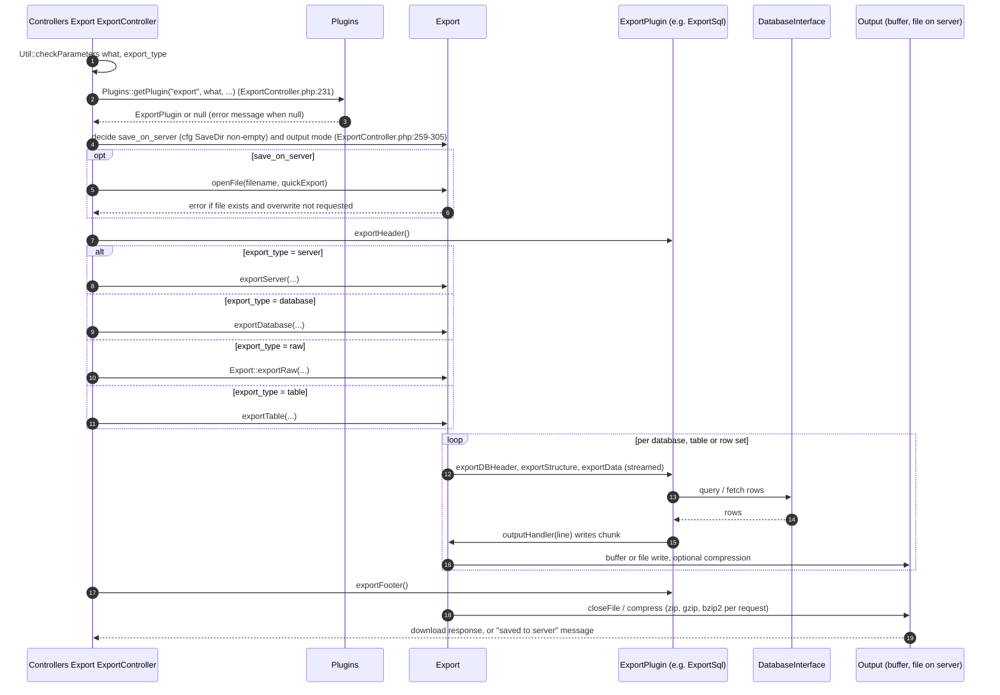

One pipeline family, many formats: the lifecycle is shared; abstract hooks (`exportHeader`, `exportFooter`, `exportDBHeader`, `exportDBFooter`, `exportDBCreate`, `exportData`) must be implemented by every format, whereas `exportStructure`, `exportRoutines`, `exportEvents`, `exportRawQuery`, `exportMetadata` have default no-op implementations in `ExportPlugin` (`ExportPlugin.php:57-193`). The per-plugin behaviour matrix is in `06-plugins.md` and `04-io-formats.md`.

## 9.8 UML sequence — SQL acceptance pipeline (corrected in review wave 1; corrected in review wave 2)

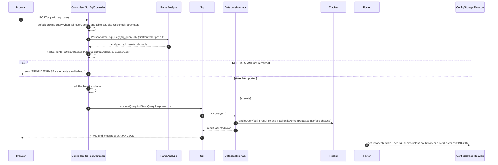

(corrected in review wave 2) This diagram is the `/sql` route (browse, sorting, links, bookmark run, single statements). The SQL tab and the console-style query box (`templates/sql/query.twig:1`, form `#sqlqueryform`) do **not** post to `/sql`: they post to `/import`, where `ImportController` (`:149-173`) sets `import_text`, `import_type='query'`, `format='sql'` and `$_SESSION['sql_from_query_box']`, optionally substitutes bind parameters, and `ImportSql::doImport` splits the text with `BufferedQuery` and `sql_delimiter` (see view 9.12, FR-DTB-021, FR-IOX-101). The `/sql` route itself never splits multi-statement text.

Evidence anchors: `Controllers/Sql/SqlController.php:120-190`, `ParseAnalyze.php:28-60`, `Sql.php:1615,1680`, `DatabaseInterface.php:211-270`, `Footer.php:194-216`, `Bookmark.php`. The multi-statement/delimiter handling (`sql_delimiter`, `Lexer::$DEFAULT_DELIMITER`) is set in `Common.php:255-260`. Failure of the query itself goes through `Generator::mysqlDie` (`DatabaseInterface.php:176-190`).

## 9.9 UML class diagram — core application skeleton (corrected in review wave 1)

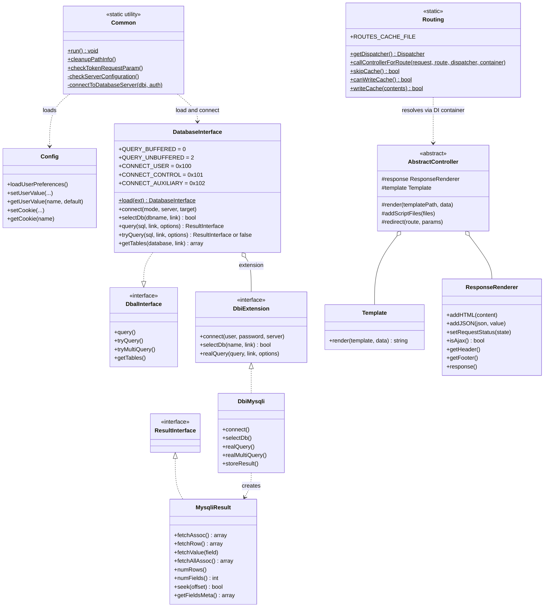

*(Simplification: HTTP verbs are matched by FastRoute; controllers are fetched from the Symfony DI container by class name and invoked as callables, `Routing.php:155-197`. Concrete controllers such as `Database\StructureController` receive `DatabaseInterface` through their own constructors; `AbstractController::__construct(ResponseRenderer, Template)` is at `Controllers/AbstractController.php:24`. The former diagram attributed `getDbList`, `tryConnect`, `free()` and `Dbal__DbiMysqli.query()` to classes that do not define them, and showed `DatabaseInterface` delegating to `DbiMysqli` by name; it holds a `DbiExtension`.)*

## 9.10 Deployment view (physical) (corrected in review wave 1)

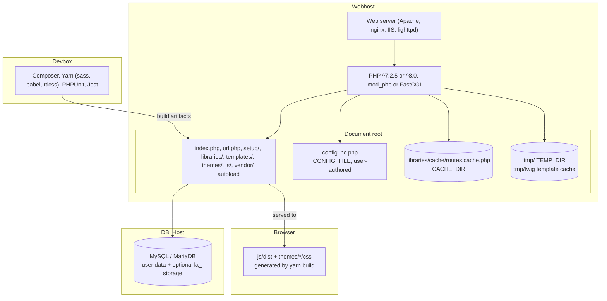

- Paths come from `libraries/vendor_config.php`: `autoloadFile` = `vendor/autoload.php` (`:20`), `tempDir` = `tmp/` (`:25`), `configFile` = `config.inc.php` (`:46`), `customHeaderFile`/`customFooterFile` = `config.header.inc.php`/`config.footer.inc.php` (`:51,56`), `cacheDir` = `libraries/cache/` (`:71`). Twig cache location: `Config::getTempDir('twig')` (`Template.php:60`). (corrected in review wave 1: the original placed the routes cache in `tmp/`+`cache/`)
- Composer creates the vendor autoloader (`AUTOLOAD_FILE`); `index.php:27-34` dies with guidance if it is missing or unreadable.
- `js/dist` and `themes/*/css` are build products (`package.json:51-60`); they are absent from the analysed source tree.
- The routes cache is written when `Routing::canWriteCache()` allows it; otherwise the route table is rebuilt per request and a warning "The routing cache could not be written ..." is raised (`Routing.php:52-120`).

## 9.11 Coverage

(Wave 2 additions: views 9.16-9.20 were verified against `AuthenticationPlugin.php`, `TwoFactor.php`, `Plugins/TwoFactor/*`, `WebAuthn/CustomServer.php`, `Tracker.php`, `Database/Designer/Common.php`, `libraries/routes.php`, `Plugins.php`, `Plugins/Export/{ExportExcel,ExportXml,ExportPdf}.php`, `Import/Ajax.php`, `sql/create_tables.sql`.)

Structural facts verified directly from source: `index.php`, `Common.php` (boot), `Routing.php`, `DatabaseInterface.php`, `Session.php`, `Plugins/*` class headers and directory listings, `TwoFactor.php`, `Controllers/*` directory listing, `Dbal/` listing, `templates/` and `themes/` listings, `sql/create_tables.sql` (all 19 tables and columns), `libraries/vendor_config.php`, `package.json`, `composer.json`. Deeper per-class behaviours were inspected by the subsystem agents and covered by documents 01–08.

## 9.12 Sequence — import data flow (added in review wave 1)

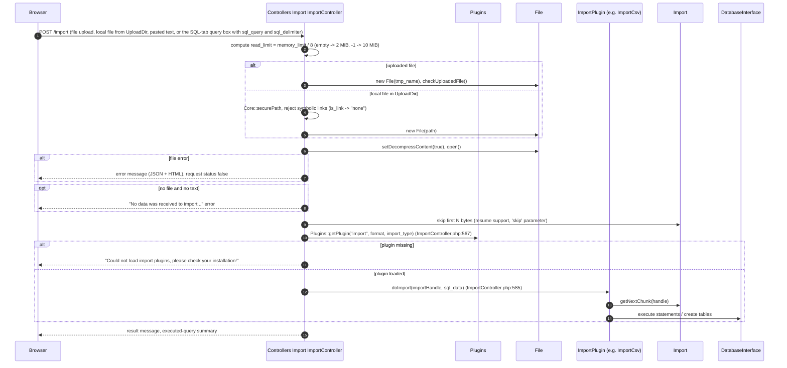

Evidence: `Controllers/Import/ImportController.php` (lines 380-640), `Plugins/ImportPlugin.php:52`, `Plugins.php:60`.

(added in review wave 2) Entry variants: for the query box the controller turns `sql_query` into `import_text` with `import_type='query'` and `format='sql'` (`ImportController.php:149-173`), so the same pipeline and `ImportSql` plugin execute typed SQL. Statements are executed by `Import::runQuery`; once the 50th queued statement is reached the queue is executed inside the import itself, and the SQL controller renders results only for imports with at most 49 statements (FR-IOX-040, corrected in wave 2). A second route `/import/simulate-dml` implements the "Simulate query" button (FR-IOX-100). Import is an `ImportPlugin` selected by `Plugins::getPlugin`, which does not check `isAvailable()` (view 9.20).

## 9.13 State diagram — route dispatch and route-cache (added in review wave 1)

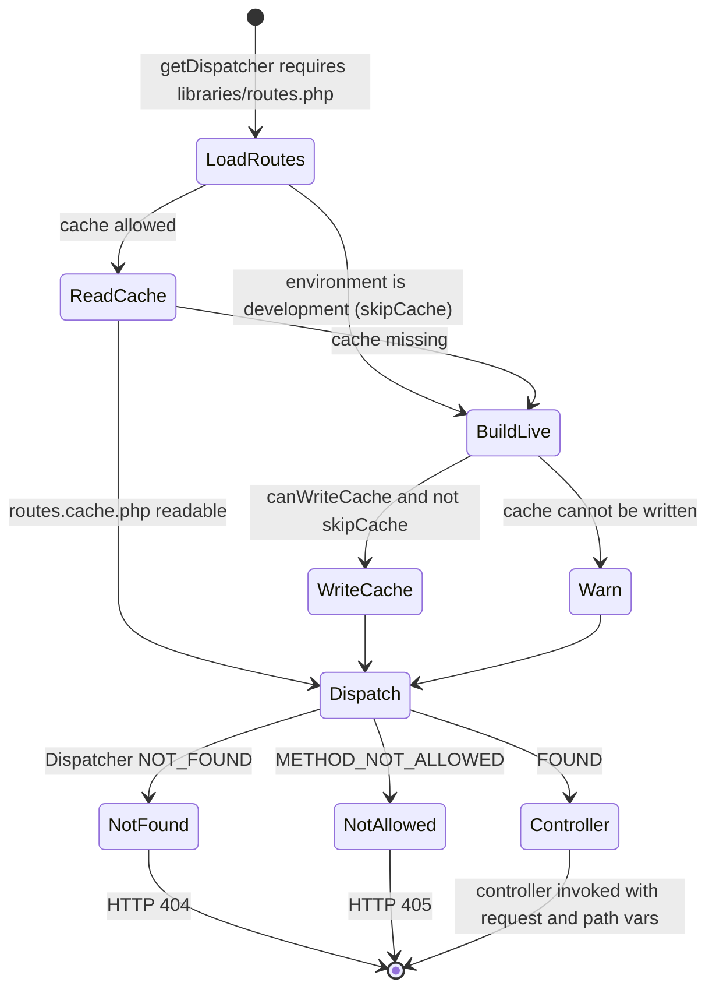

Evidence: `Routing.php:38-120,155-197`.

## 9.14 Component view — configuration storage features (added in review wave 1)

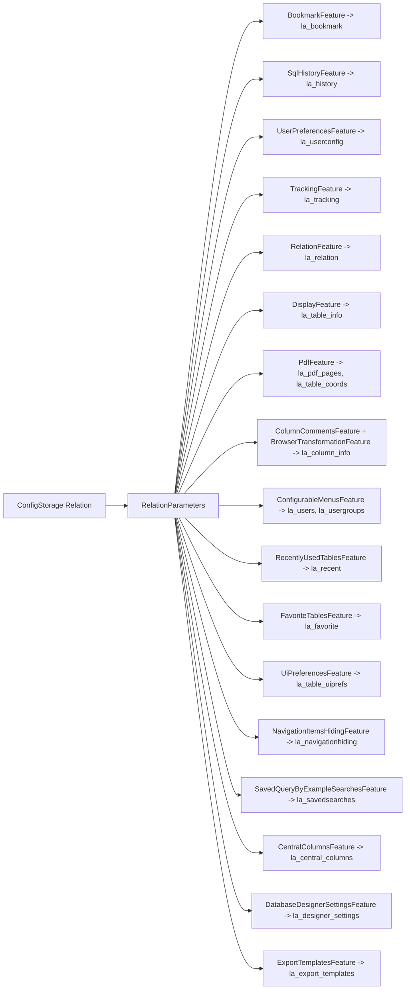

Evidence: `libraries/classes/ConfigStorage/Features/` (the directory contains 18 feature classes, shown above as 17 nodes because `ColumnCommentsFeature` and `BrowserTransformationFeature` share `la_column_info`; together they cover all 19 tables), `ConfigStorage/RelationParameters.php`. Each feature is individually enabled only when its table is configured and exists; otherwise the feature is reported unavailable (see `01-configuration.md`, `03-database-table.md`).

## 9.15 Component view — Dbal layering and result access (added in review wave 1)

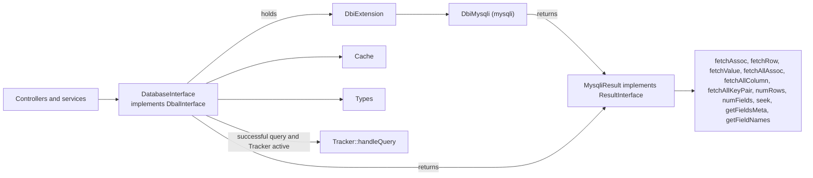

Evidence: `DatabaseInterface.php:78,153-163,211-270`, `Dbal/DbiMysqli.php:41`, `Dbal/MysqliResult.php:26-265`.

## 9.16 Sequence — two-factor check, TOTP and WebAuthn (added in review wave 2)

Evidence: `AuthenticationPlugin::checkTwoFactor` (`AuthenticationPlugin.php:328-359`), `TwoFactor::getAvailableBackends/getBackendClass` (`TwoFactor.php:129-205`), `Plugins/TwoFactor/Application.php:38-126`, `Plugins/TwoFactor/WebAuthn.php:62-160`, `WebAuthn/CustomServer.php:76-110`. Specified in `05-security-auth.md` FR-SAU-054, FR-SAU-058..064.

```mermaid
sequenceDiagram
    autonumber
    participant B as Browser
    participant C as Common::run
    participant A as AuthenticationPlugin
    participant TF as TwoFactor
    participant P as TwoFactorPlugin (Application or WebAuthn)
    participant S as WebAuthn Server (CustomServer or WebauthnLibServer)

    C->>A: rememberCredentials(), then checkTwoFactor() (Common.php:238-240)
    A->>TF: new TwoFactor(user), check()
    alt no backend configured or already verified in session
        TF-->>A: true, request continues
    else backend configured
        TF->>P: check() (backend class from getBackendClass; unavailable backend gives Invalid, always false)
        alt Application (TOTP only)
            P->>P: Google2FA verifyKey(secret, POST 2fa_code), window +-8 steps
        else WebAuthn
            P->>P: needs POST webauthn_request_response and session WebAuthnCredentialRequestOptions (unset on use)
            P->>S: parseAndValidateAssertionResponse(response, allowedCredentials, challenge, request)
            Note over S: Selection (WebAuthn.php:64): WebauthnLibServer if web-auth/webauthn-lib is installed, else CustomServer. CustomServer variant only (corrected in review wave 3): checks type webauthn.get, credential id in allow-list, challenge (hash_equals), origin host equals request host, rpIdHash, user-present flag; it does NOT verify the assertion signature or the sign counter. Library variant: delegated to loadAndCheckAssertionResponse, not verifiable in this tree. See FR-SAU-210, CF-004.
            S-->>P: returns, or Assert exception (message shown to user)
        end
        alt check true
            TF-->>A: true, request continues
        else check false
            A-->>B: login/twofactor form (render()), exit
        end
    end
```

Notes: the credential cookies are already issued by `rememberCredentials()` before the 2FA form is shown (FR-SAU-045). `WebauthnLibServer` is used instead of `CustomServer` when the vendor class `Webauthn\Server` exists (`WebAuthn.php:62-65`); the vendor library is not in the analysed tree, so its signature handling is not verifiable here. The `Key` (U2F) backend is selectable only when `U2FServer` exists; its challenge is not single-use (SEC-SAU-306). `WebAuthn` is always listed as available (`TwoFactor.php:141`).

## 9.17 Sequence — tracking capture and data model (added in review wave 2)

Evidence: `DatabaseInterface.php:267-269`, `Tracker.php:61-75,836-975`, `Common.php:204,294`, `sql/create_tables.sql:207-224`. Specified in `03-database-table.md` FR-DTB-150, FR-DTB-151, DATA-DTB-004.

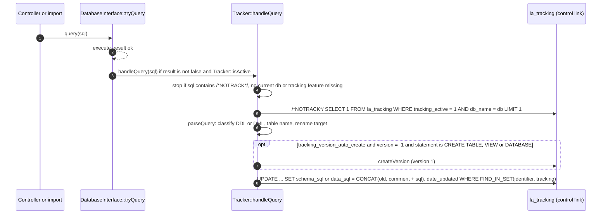

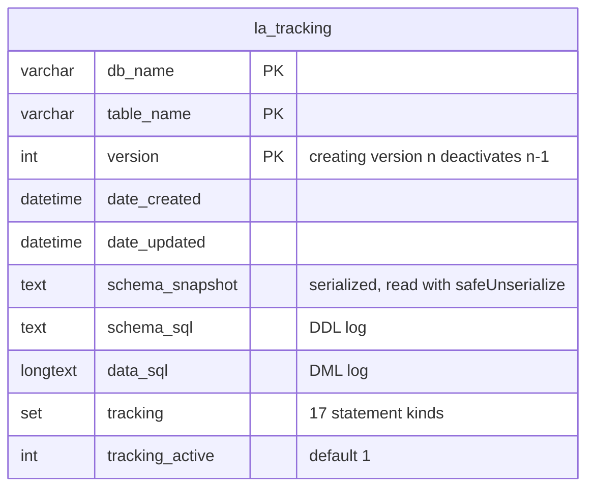

Tracking is invoked from the DBAL layer, not from the SQL controller, so it also fires for statements run by import, designer and other controllers. `Tracker::enable()` runs at the end of the boot (`Common.php:294`).

## 9.18 Designer pages and coordinates (added in review wave 2)

Evidence: `sql/create_tables.sql:98-106,178-187,331-337`, `Database/Designer/Common.php:269-516,765-800`. Specified in FR-DTB-120, DATA-DTB-005.

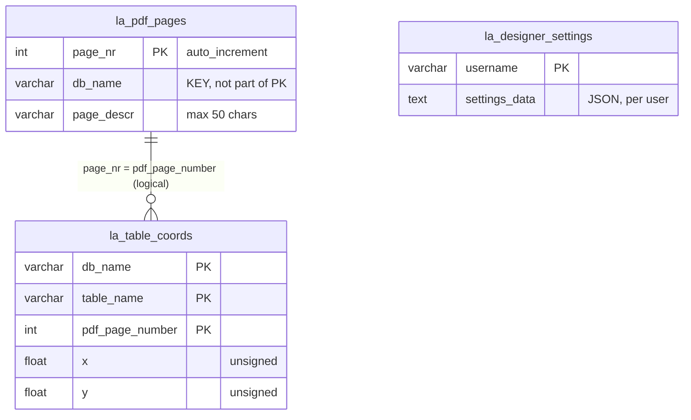

Behaviour that the data model allows or implies: the primary key of `la_pdf_pages` is `page_nr` alone, so page names are not unique per database by schema; the application checks name uniqueness over all databases (the query has no `db_name` filter) and `deletePage` deletes by `page_nr` only (FR-DTB-120, listed as a legacy quirk in `00-overview.md` section 6). Saving over an existing page deletes all its `table_coords` rows and re-inserts them.

## 9.19 Server route catalogue (added in review wave 2)

Evidence: `libraries/routes.php:145-203` (re-verified in wave 2), specified in `02-server.md` FR-SRV-057. Methods are given per node; `*` means GET and POST.

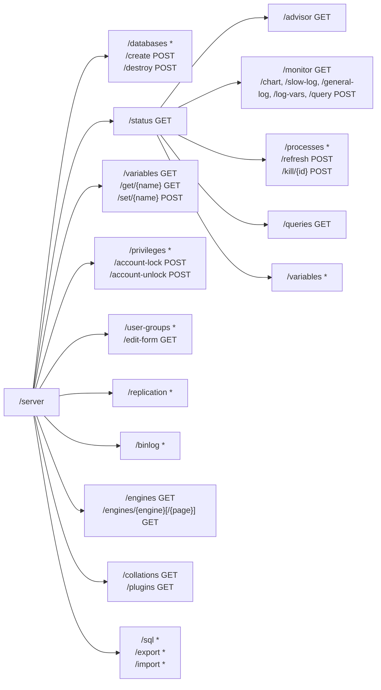

The three predicates that are the only LegacyAdmin-side authorisation checks for these routes are `isSuperUser()` (the account can read `mysql.user`; it is not the MySQL `SUPER` privilege), `isGrantUser()` and `isCreateUser()` (SEC-SRV-009, SEC-SAU-322). `Routing.php` contains no router-level authorisation middleware (SEC-SAU-321).

## 9.20 Import and export plugin selection and availability (added in review wave 2)

Evidence: `Plugins.php:60-73,119-150`, `Plugins/Export/ExportXml.php:551-557`, `Plugins/Export/ExportPdf.php:334-337`, `Import/Ajax.php:40-66`, `Controllers/Export/ExportController.php:231`, `Controllers/Import/ImportController.php:567`. Specified in FR-IOX-001, FR-IOX-039, FR-IOX-060, FR-PLG-001, FR-PLG-005, DEP-PLG-003.

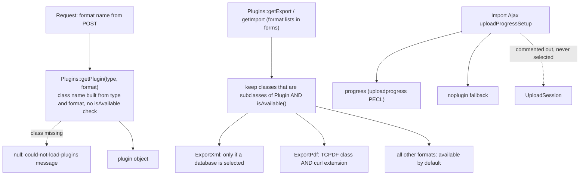

"Excel" in the export list is `ExportExcel extends ExportCsv` (CSV with Excel-oriented separators); there is no XLSX writer in the plugin set. The spreadsheet-like formats are ODS (export and import) and ODT (export).
